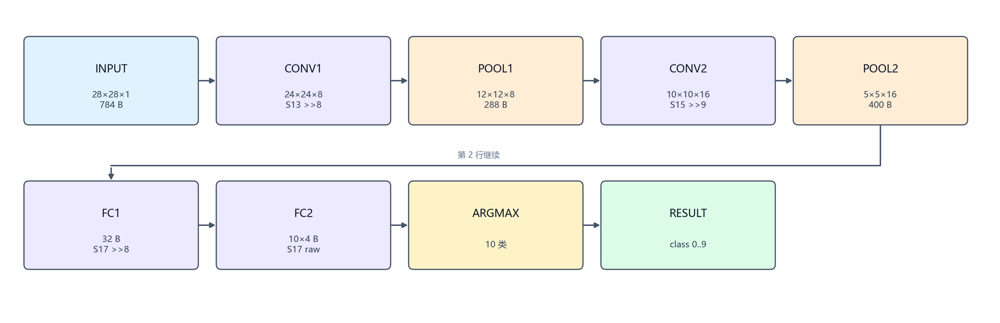
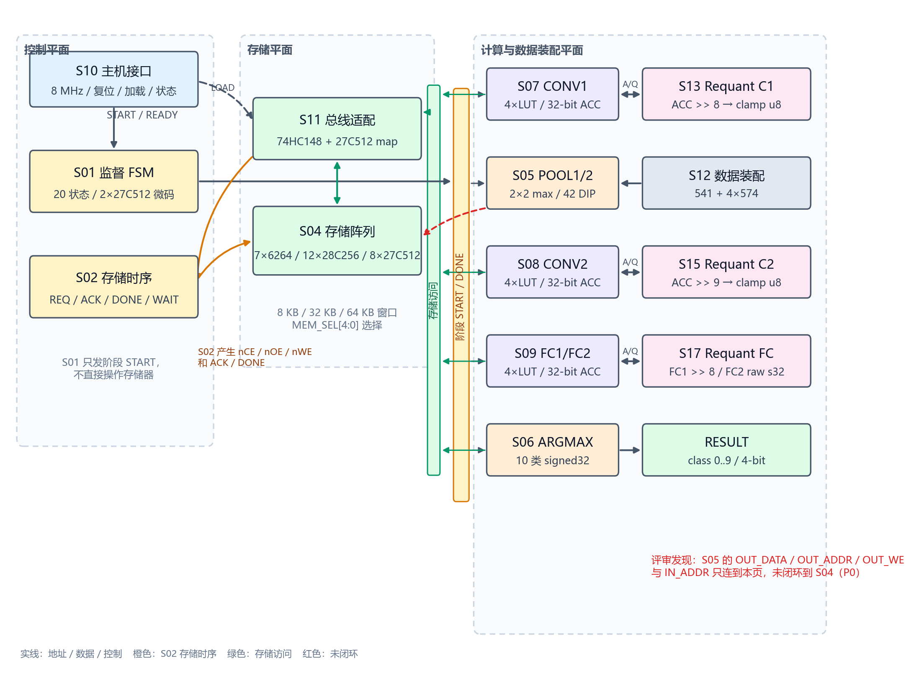
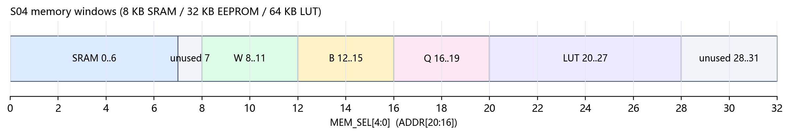
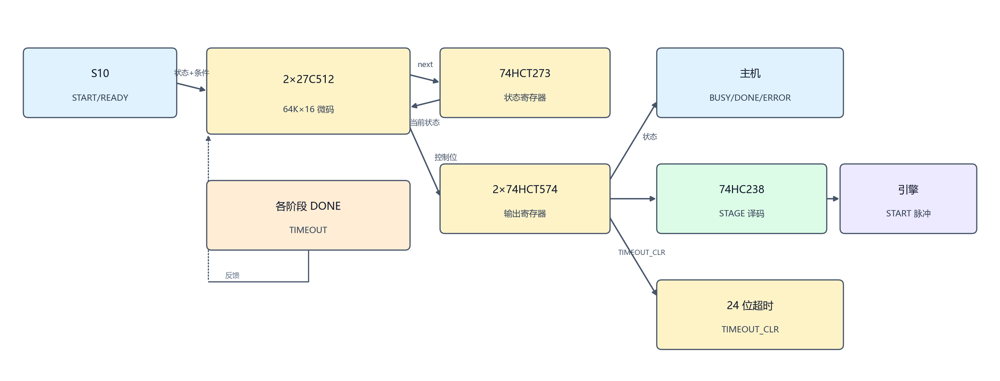
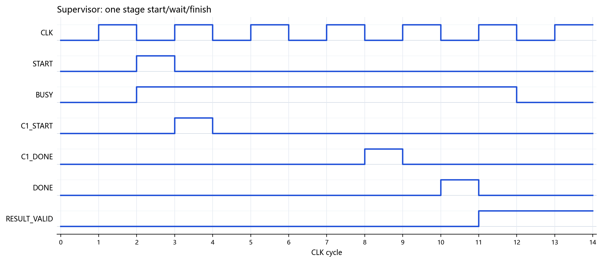
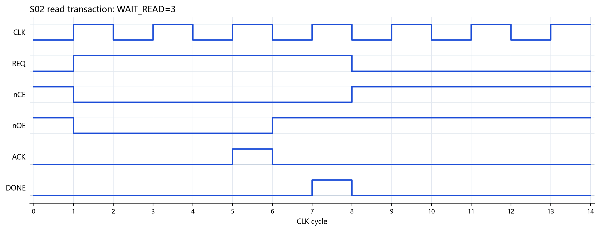
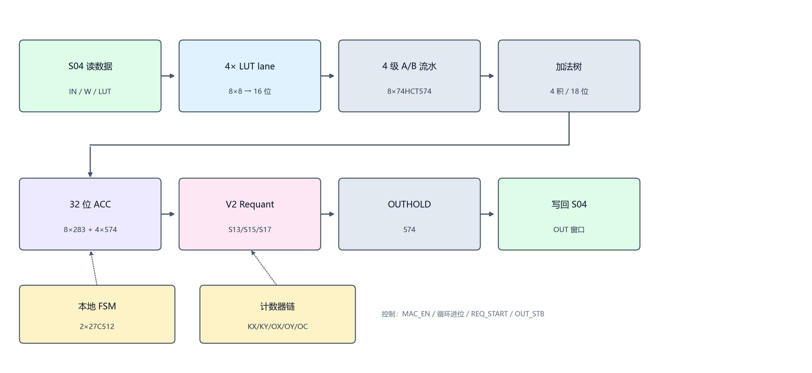
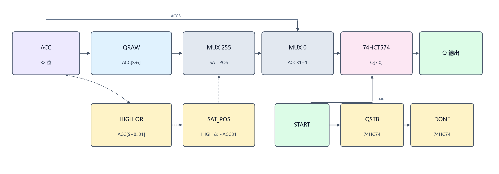
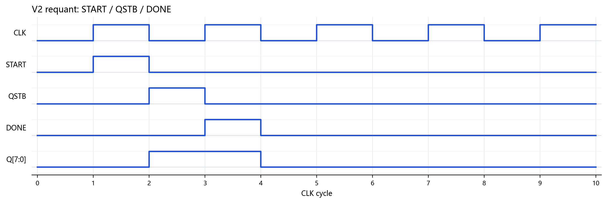
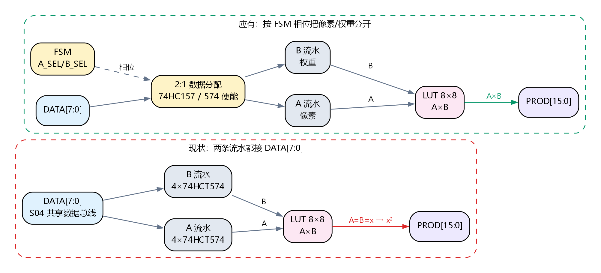

# 0. 文档范围与结论

本文件面向**原理图评审**，不是数据手册，也不是投板放行文件。它把当前 `CNN_74xx_System`（V2）的模块拓扑、端到端推理过程、S01 微码、S02 存储时序、S07/S08/S09 引擎流水线、S13/S15/S17 Requant 以及已经发现的连接/验证缺口放在同一张图上，便于逐页对照原理图审阅。

**评审基线**

| 项目 | 当前值 |
|---|---|
| 顶层 | `CNN_74xx_System.kicad_sch`，14 张子图：S01、S02、S04–S13、S15、S17 |
| 工艺 | 74HC/HCT 逻辑、6264 SRAM、28C256 EEPROM、27C512 ROM/LUT |
| 数据通路 | 8 位共享数据总线、32 位累加器、4 条 LUT 乘法 lane |
| 量化 | V2：对称、零 bias、每层统一 2^S、直接截断 |
| DIP IC | **576 片**（BOM 总计 1011 件，另有 12 个未展开 `LUT_Mult_Unit` 块） |
| 顶层 ERC | **0 errors / 940 warnings** |
| 回归 | `sim/run_all.py` **11/11 PASS** |
| 顶层 PDF | `output/pdf/CNN_74xx_System.pdf`，15 页 |

**先给结论**

1. **架构是“单总线 + 串行阶段 + 微码控制”**：同一时刻只有一个计算引擎访问 S04，S01 只负责阶段排序，S02 只负责存储时序。这个结构可以用约 576 片 DIP 实现 28×28 CNN，但吞吐完全受 8 位总线限制。
2. **V2 Requant 已经足够简单**：S13/S15/S17 只做 `ACC >> S`、负数和正溢出钳位，没有乘法器、零点、bias 或参数装载器；三块合计 50 片，原理图可以逐门读懂。
3. **但当前网表有四个必须先处理的 P0 问题**：

   - **P0‑1**：S07/S08/S09 的 A、B 两条操作数流水都接在 `DATA[7:0]` 上，LUT 实际计算的是 `x*x`，不是“像素×权重”。地址/计数器测试发现不了这个问题。
   - **P0‑2**：S05 Pool 的 `IN_ADDR[12:0]`、`OUT_ADDR[11:0]`、`OUT_DATA[7:0]`、`OUT_WE`、`POOL_BUSY` 只连到 S05 本页，没有闭环到 S04/S11。Pool 能收到 `IN_DATA`，但不能寻址输入，也不能写输出。
   - **P0‑3**：S07/S08/S09 的本地 FSM 只画了状态/控制位定义，**没有生成 2×27C512 微码镜像**，也没有逐状态仿真；ROM 是空的，板子上不会动。
   - **P0‑4**：12 个 `LUT_Mult_Unit` 仍是块符号，没有展开成 27C512 封装和地址/数据缓冲；BOM 不能直接投板。

4. **因此当前状态是“架构可评审、不可投板”**。本 PDF 把“设计意图”和“网表实际连接”分开写，凡是网表没有闭环的地方都用红字标出，避免把意图当成已实现。

# 1. 系统总览

## 1.1 网络与阶段

28×28 MNIST CNN 的八段计算：

```text
INPUT 28×28×1
  → CONV1 5×5, 1→8, 24×24×8
  → POOL1 2×2/2, 12×12×8
  → CONV2 3×3, 8→16, 10×10×16
  → POOL2 2×2/2, 5×5×16
  → FC1 400→32
  → FC2 32→10
  → ARGMAX 10 类
  → RESULT class 0..9
```



*图 1：端到端数据流。每个方框的第三行是输出字节数；S13/S15/S17 的移位值直接标在对应阶段内。*

| 阶段 | 输入尺寸 | 输出尺寸 | 输出字节 | MAC/输出点 | 总 MAC | 主要引擎 |
|---|---|---:|---:|---:|---:|---|
| CONV1 | 28×28×1 | 24×24×8 | 4,608 | 25 | 115,200 | S07 + S13 |
| POOL1 | 24×24×8 | 12×12×8 | 1,152 | 4 读/点 | 4,608 读 | S05 |
| CONV2 | 12×12×8 | 10×10×16 | 1,600 | 72 | 115,200 | S08 + S15 |
| POOL2 | 10×10×16 | 5×5×16 | 400 | 4 读/点 | 1,600 读 | S05 |
| FC1 | 400 | 32 | 32 | 400 | 12,800 | S09 + S17 |
| FC2 | 32 | 10 | 40 | 32 | 320 | S09 + S17 |
| ARGMAX | 10×signed32 | class 0..9 | 4 bit | — | 40 读 | S06 + S12 |

总 MAC：`115200 + 115200 + 12800 + 320 = 243,520`。总输出写字节：`4608 + 1152 + 1600 + 400 + 32 + 40 = 7,832`。

## 1.2 为什么只有 576 片

用户原先预计 200–300 片，实际 DIP 576 片；如果展开 12 个 LUT 块，还会增加 24 片 27C512（按“每 lane 2 片”的方案）。数量看起来少，原因是：

1. **串行复用**：CONV1、POOL1、CONV2、POOL2、FC1、FC2、ARGMAX 不同时运行，共用一套 S04 存储阵列和一套 8 位数据总线。全并行会需要 8×24×24 个卷积单元，数量会爆炸。
2. **4-lane 乘加**：每个引擎只有 4 个 8×8 LUT 乘法器，靠 4 级流水和 32 位 ACC 完成 25/72/400 次 MAC，而不是每个 MAC 一个乘法器。
3. **微码控制**：S01 用 2×27C512 存 64K×16 微码，S07/S08/S09 各用 2×27C512 存本地 FSM 控制字；控制逻辑被收进 ROM，而不是用大量随机门搭。
4. **8 位总线**：所有特征图、权重、LUT 地址都走同一组 `DATA[7:0]`，存储阵列按窗口切换，不需要每层一套独立 SRAM。
5. **V2 Requant 极简**：S13/S15 各 13 片、S17 24 片，合计 50 片；旧版通用 Requant 三块合计 1368 片，是当前规模差异的最大来源。

## 1.3 三平面拓扑



三个平面的职责：

- **控制平面（S10/S01/S02）**：S10 产生时钟/复位/加载口；S01 是唯一阶段调度源，输出 7 个 `*_START`；S02 只把 S11 的 `REQ/WE` 变成 `nCE/nOE/nWE` 和 `ACK/DONE`。
- **存储平面（S11/S04）**：S11 把“哪个引擎、哪个区域”翻译成 `MEM_SEL[4:0]`；S04 根据 `MEM_SEL` 选中 7 片 6264、12 片 28C256、8 片 27C512 中的一片，并把 16 位窗口地址送到器件。
- **计算/装配平面（S05–S09、S12、S13/S15/S17）**：S07/S08/S09 是三个 4-lane 乘加引擎；S05 做 2×2 max pooling；S06 做 10 类 signed32 argmax；S12 把 8 位 `DATA` 拼成 Pool 输入和 Argmax 32 位分数；S13/S15/S17 做 V2 requant。

*图 2：控制平面、存储平面、计算/装配平面。橙色是 S02 存储时序，绿色是 S11 存储访问，红色是当前网表未闭环的 Pool 路径。*

# 2. 模块间连线与拓扑

## 2.1 全局网络分类

| 类别 | 网络 | 源 | 目的 | 说明 |
|---|---|---|---|---|
| 时钟/复位 | `CLK`、`RESET_N` | S10 | S01/S02/S04–S09/S13/S15/S17 | 单时钟；S10 默认 8 MHz，可切外部时钟 |
| 主机加载 | `LOAD_EN`、`LOAD_ADDR[23:0]`、`LOAD_DATA[7:0]`、`LOAD_nOE`、`LOAD_nWE`、`IMAGE_DONE_N`、`MODEL_DONE_N` | S10 | S04 | 主机把图像/权重写进 SRAM/EEPROM |
| 就绪 | `IMAGE_READY`、`MODEL_READY` | S04 就绪锁存 | S01/S10 | 只有二者都为 1，S01 才离开 WAIT_READY |
| 阶段启动 | `C1_START`、`P1_START`、`C2_START`、`P2_START`、`FC1_START`、`FC2_START`、`ARGMAX_START` | S01 | 对应引擎 | 单时钟脉冲，经 74HC238 译码 |
| 阶段完成 | `C1_DONE`、`P1_DONE`、`P2_DONE`、`C2_DONE`、`FC1_DONE`、`FC2_DONE`、`ARGMAX_DONE` | 引擎 | S01 | 与 `BUSY` 一起构成握手 |
| 存储请求 | `C1/C2/FC_ADDR[15:0]`、`C1/C2/FC_BUSY_N`、`C1/C2/FC_MEM_REQ`、`C1/C2/FC_MEM_WE` | 引擎 | S11 | 只有活动引擎驱动自己的地址 |
| 存储映射 | `MEM_SEL[4:0]`、`ADDR[23:16]` | S11 | S04 | `ADDR[23:16]={000,MEM_SEL}` |
| 存储时序 | `REQ`、`WE`、`MEM_nCE`、`MEM_nOE`、`MEM_nWE`、`MEM_ACK`、`MEM_DONE`、`MEM_BUSY` | S11/S02 | S04/引擎 | S02 是唯一时序源 |
| 数据 | `DATA[7:0]` | S04 读 / 引擎写 | S04/S12 | 双向共享；S12 缓冲出 `IN_DATA` |
| Requant | `C1/C2/FC_ACC[31:0]`、`C1/C2/FC_REQ_START`、`C1/C2/FC_REQ_Q[7:0]`、`*_QSTB`、`*_SAT_FLAG`、`*_REQ_BUSY`、`*_REQ_DONE` | 引擎/S13/S15/S17 | 互为握手 | V2 固定移位 |
| 结果 | `RESULT_IN[3:0]`、`RESULT[3:0]`、`RESULT_VALID`、`BUSY`、`DONE`、`ERROR` | S06/S01 | S01/S10 | S01 锁存后送主机 |

## 2.2 模块连接总表

| 源 | 目的 | 信号 | 方向 | 备注 |
|---|---|---|---|---|
| S10 | S01 | `START`、`IMAGE_READY`、`MODEL_READY` | → | START 同步后进 S01 |
| S10 | S04 | `LOAD_ADDR[23:0]`、`LOAD_DATA[7:0]`、`LOAD_EN`、`LOAD_nOE`、`LOAD_nWE` | → | 主机加载 |
| S10 | S04 | `IMAGE_DONE_N`、`MODEL_DONE_N` | → | 低有效加载完成脉冲 |
| S01 | S07 | `C1_START` | → | 阶段 3 |
| S07 | S01 | `C1_DONE` | → | Conv1 最后一字节写完 |
| S01 | S05 | `P1_START`、`P2_START`、`POOL_SEL` | → | `POOL_SEL=0` 为 P1，`=1` 为 P2 |
| S05 | S01 | `P1_DONE`、`P2_DONE` | → | 由 `POOL_DONE` 与 `POOL_SEL` 分解 |
| S01 | S08 | `C2_START` | → | 阶段 7 |
| S08 | S01 | `C2_DONE` | → | Conv2 最后一字节写完 |
| S01 | S09 | `FC1_START`、`FC2_START`、`FC_SEL` | → | `FC_SEL=0` 为 FC1，`=1` 为 FC2 |
| S09 | S01 | `FC1_DONE`、`FC2_DONE` | → | FC1/FC2 各自完成 |
| S01 | S06 | `ARGMAX_START` | → | 阶段 15 |
| S06 | S01 | `ARGMAX_DONE`、`RESULT_IN[3:0]` | → | 结果进 S01 锁存 |
| S07 | S11 | `C1_ADDR[15:0]`、`C1_BUSY_N`、`C1_MEM_REQ`、`C1_MEM_WE` | → | 仅 C1_BUSY=1 时驱动 |
| S08 | S11 | `C2_ADDR[15:0]`、`C2_BUSY_N`、`C2_MEM_REQ`、`C2_MEM_WE` | → | 仅 C2_BUSY=1 时驱动 |
| S09 | S11 | `FC_ADDR[15:0]`、`FC_BUSY_N`、`FC_MEM_REQ`、`FC_MEM_WE` | → | 仅 FC_BUSY=1 时驱动 |
| S11 | S04 | `ADDR[23:16]`、`MEM_SEL[4:0]` | → | 标签 + 窗口选择 |
| S11 | S02 | `REQ`、`WE` | → | 三引擎请求合并 |
| S02 | S04 | `MEM_nCE`、`MEM_nOE`、`MEM_nWE` | → | 低有效 |
| S02 | S07/S08/S09 | `MEM_ACK`、`MEM_DONE`、`MEM_BUSY` | → | 共享握手广播 |
| S07 | S13 | `C1_ACC[31:0]`、`C1_REQ_START` | → | V2 requant 输入 |
| S13 | S07 | `C1_REQ_Q[7:0]`、`C1_REQ_QSTB`、`C1_SAT_FLAG`、`C1_REQ_BUSY`、`C1_REQ_DONE` | → | 回写握手 |
| S08 | S15 | `C2_ACC[31:0]`、`C2_REQ_START` | → | V2 requant 输入 |
| S15 | S08 | `C2_REQ_Q[7:0]`、`C2_REQ_QSTB`、`C2_SAT_FLAG`、`C2_REQ_BUSY`、`C2_REQ_DONE` | → | 回写握手 |
| S09 | S17 | `FC_ACC[31:0]`、`FC_REQ_START`、`FC_SEL` | → | FC1/FC2 共用 |
| S17 | S09 | `FC_REQ_Q[7:0]`、`FC_REQ_QSTB`、`FC_SAT_FLAG`、`FC_REQ_BUSY`、`FC_REQ_DONE` | → | FC2 四字节 |
| S12 | S05 | `IN_DATA[7:0]` | → | 由 `DATA[7:0]` 缓冲 |
| S06 | S12 | `SCORE_ADDR[5:0]` | → | `{class,byte}=class*4+byte` |
| S04 | S12 | `DATA[7:0]` | → | S12 用 4×574 拼 32 位 |
| S06 | S04 | `SCORE_ADDR[5:0]` | → | 经 S11 master 4 访问 FC2_LOGITS |
| S06 | S01 | `ARGMAX_DONE` | → | 结果有效 |
| S05 | S04 | `IN_ADDR[12:0]`、`OUT_ADDR[11:0]`、`OUT_DATA[7:0]`、`OUT_WE` | **未连接** | 当前网表只有 S05 单端；见 2.6 |
| S05 | S01 | `POOL_BUSY` | **未连接** | 只有 S05 测试点；见 2.6 |

## 2.3 S11 总线适配

S11 解决“三个引擎 + Argmax 共用一套 S04”的映射问题。它不仲裁，因为 S01 已经串行化阶段；它只做组合翻译：

```text
MASTER[2:0] = encode(C1_BUSY, C2_BUSY, FC_BUSY, ARGMAX_BUSY)
REGION[2:0] = encode(Cx_MEM_nCE_IN/W/OUT/B/Q/MC)
map_ROM[A] = {FC_SEL, MASTER[1:0], REGION[2:0], 1'b0}
map_ROM[D4:0] = MEM_SEL[4:0]
```

| MASTER | 引擎 | 说明 |
|---:|---|---|
| 0 | 无/主机 | 空闲 |
| 1 | C1 | S07 |
| 2 | C2 | S08 |
| 3 | FC | S09 |
| 4 | ARGMAX | S06 |

| 区域 | REGION | C1 | C2 | FC1 | FC2 | ARGMAX |
|---|---:|---:|---:|---:|---:|---:|
| IN | 0 | 0 INPUT | 2 POOL1_OUT | 4 POOL2_OUT | 5 FC1_OUT | 6 FC2_LOGITS |
| W | 1 | 8 W_CONV1 | 9 W_CONV2 | 10 W_FC1 | 11 W_FC2 | 6 FC2_LOGITS |
| OUT | 2 | 1 CONV1_OUT | 3 CONV2_OUT | 5 FC1_OUT | 6 FC2_LOGITS | 6 FC2_LOGITS |
| B | 3 | 12 B_CONV1 | 13 B_CONV2 | 14 B_FC1 | 15 B_FC2 | 6 FC2_LOGITS |
| Q | 4 | 16 Q_CONV1 | 17 Q_CONV2 | 18 Q_FC1 | 19 Q_FC2 | 6 FC2_LOGITS |
| MC | 5 | 20 LUT0 | 22 LUT1 | 24 LUT2 | 26 LUT3 | 6 FC2_LOGITS |

V2 不再使用 B/Q 窗口（bias=0、无 qparam），但 S11/S04 仍保留这些窗口，属于“硬件保留、当前模型不用”。Argmax 的 8 个 region 全部映射到 `MEM_SEL=6`，所以无论 S06 输出哪个 region 码，都读 `FC2_LOGITS`。

`REQ/WE` 合并：三个引擎的 `*_MEM_REQ`、`*_MEM_WE` 经 74HC32/74HC08 合并成全局 `REQ`、`WE`，送 S02。因为 S01 保证同一时刻只有一个引擎处于 BUSY，所以不需要优先级仲裁；如果将来允许重叠阶段，这里必须加仲裁。

## 2.4 S04 存储映射



*图 3：`MEM_SEL[4:0]` 的 32 个 64 KB 窗口。0–6 是 6264 SRAM，8–11 是权重 EEPROM，12–15 bias，16–19 qparam，20–27 LUT ROM，7/28–31 未映射。*

| MEM_SEL | 器件 | 容量 | 用途 | V2 是否使用 |
|---:|---|---:|---|---|
| 0 | 6264 | 8 KB | INPUT | 是 |
| 1 | 6264 | 8 KB | CONV1_OUT | 是 |
| 2 | 6264 | 8 KB | POOL1_OUT | 是 |
| 3 | 6264 | 8 KB | CONV2_OUT | 是 |
| 4 | 6264 | 8 KB | POOL2_OUT | 是 |
| 5 | 6264 | 8 KB | FC1_OUT | 是 |
| 6 | 6264 | 8 KB | FC2_LOGITS | 是 |
| 7 | — | — | 未映射 | 否 |
| 8–11 | 4×28C256 | 4×32 KB | W_CONV1/W_CONV2/W_FC1/W_FC2 | 是 |
| 12–15 | 4×28C256 | 4×32 KB | B_CONV1/B_CONV2/B_FC1/B_FC2 | 否（bias=0） |
| 16–19 | 4×28C256 | 4×32 KB | Q_CONV1/Q_CONV2/Q_FC1/Q_FC2 | 否（固定移位） |
| 20–27 | 8×27C512 | 8×64 KB | LUT0–LUT3 的低/高字节 | 是（待展开） |
| 28–31 | — | — | 未映射 | 否 |

窗口地址：`ADDR[23:16]={000,MEM_SEL}`，`ADDR[15:0]` 是窗口内偏移。S04 用 74HC688 比较 `ADDR[23:16]` 与 `{000,MEM_SEL}`，只有标签匹配才允许片选，避免地址/窗口错配时误写。

## 2.5 主机加载与就绪

主机通过 S10 的加载口写 S04：

```text
LOAD_EN=1
LOAD_ADDR[23:0] = {MEM_SEL, offset}
LOAD_DATA[7:0]  = byte
LOAD_nWE / LOAD_nOE 选写/读
→ 写完后脉冲 IMAGE_DONE_N 或 MODEL_DONE_N
→ S04 就绪锁存置 IMAGE_READY / MODEL_READY
→ S01 离开 G_WAIT_READY
```

图像 784 B；V2 权重总量 `200 + 1152 + 12800 + 320 = 14,472 B`（Conv1 200、Conv2 1152、FC1 12800、FC2 320）。LUT 表由 27C512 预烧，不走上电加载。bias/qparam 窗口保留但不使用。

**注意**：28C256 是 EEPROM，字节写需要内部写周期；当前 `LOAD_nWE` 只按 SRAM 风格给一个写脉冲，EEPROM 写入时序/轮询没有在原理图中展开。这是 P1 项，投板前必须核对。

## 2.6 网表实测：哪些“连接”其实没有连

顶层审计脚本报告“2 个单节点网”，但那是按两个名字过滤的结果。直接解析 `output/top.net` 后发现，**S05 的 35 个模块边界网也只连到 S05 本页**：

| 网络 | 唯一节点 | 应该连到 |
|---|---|---|
| `IN_ADDR0..12` | U5022–U5025 | S04 地址输入 / S11 |
| `OUT_ADDR0..11` | U5026–U5028 | S04 地址输入 / S11 |
| `OUT_DATA0..7` | U5011 | S04 `DATA[7:0]` |
| `OUT_WE` | U5039.18 | S02 / S04 写使能 |
| `POOL_BUSY` | U5039.16 | S01 或状态测试点 |
| `ARGMAX_RESULT_VALID` | U6034.11 | 仅测试点；S01 用的是微码 `RESULT_VALID`，不是这个网 |

Pool 只通过 S12 收到 `IN_DATA[7:0]`，但没有地址、没有写回、没有 `OUT_WE`。因此当前网表**无法完成 POOL1/POOL2**。这不是“ERC warning”，而是功能缺失；ERC 不会报，因为每个网只有一个引脚时只是“单节点”，不是“未驱动”。

修复建议（按侵入性从小到大）：

1. **给 S05 增加 S11 master**：`POOL_MEM_REQ/WE`、`POOL_MEM_nCE_IN/OUT`，区域码 IN=0、OUT=2；S11 map ROM 增加 Pool 行，`MEM_SEL` 分别映射到 `CONV1_OUT/POOL1_OUT`（P1）和 `CONV2_OUT/POOL2_OUT`（P2）。
2. **S05 的 13 位 `IN_ADDR` / 12 位 `OUT_ADDR` 经 74HCT541 接到 S04 `ADDR[15:0]`**，`OUT_DATA` 经 74HCT245 接到 `DATA[7:0]`，`OUT_WE` 接 S02 的写请求。
3. **`POOL_BUSY` 接 S01 的忙状态或至少接一个测试点**；`ARGMAX_RESULT_VALID` 若只是测试点，应在审计脚本中标记为“测试点”，不要与功能网混在一起。

# 3. 从输入到结果的完整过程

## 3.1 上电与复位

1. S10 的 8 MHz 有源晶振起振，`CLK` 经 33 Ω 串联电阻送到全系统。
2. `R1=100k`、`C90=1u` 产生上电复位；`74HC04` 整形后得到 `RESET_N`。时间常数 `100k×1u=0.1 s`，按 74HC 阈值约 **69 ms** 后释放。
3. S01 状态寄存器被异步清到 `G_RESET(0)`；S07/S08/S09 本地 FSM 清到 `E_RESET(0)`；S05/S06 清到 IDLE；S13/S15/S17 的 QSTB/DONE 触发器清零。
4. S01 下一拍进入 `G_WAIT_READY(1)`，等待 `IMAGE_READY & MODEL_READY`。S04 的就绪锁存在加载完成前保持 0。

## 3.2 主机加载

1. 主机置 `LOAD_EN=1`，S04 的地址/数据/控制输入从 S10 加载口进入。
2. 写 INPUT 窗口 0：784 B。
3. 写权重窗口 8–11：14,472 B。V2 没有 bias/qparam，因此窗口 12–19 可以不写。
4. 每写完一块，脉冲对应的 `IMAGE_DONE_N` / `MODEL_DONE_N`；S04 置 `IMAGE_READY` / `MODEL_READY`。
5. S01 看到两个 ready 后进入 `G_IDLE(2)`，`BUSY=0`，等待 `START`。

> 当前 `LOAD_EN` 与引擎 `BUSY` 没有硬件互锁。推理期间如果主机误置 `LOAD_EN=1`，会与活动引擎争用 S04 地址/片选。建议在 S10 加载口增加 `LOAD_EN & ~BUSY` 的门控，或在 S04 的地址 mux 上增加 `BUSY` 优先。

## 3.3 START 与阶段 0

1. 主机给 S10 一个 `START` 脉冲；S10 同步后送 S01。
2. S01 在 `G_IDLE(2)` 看到 `START & ready`，下一拍进入 `G_C1_START(3)`。
3. 状态 3 的输出：`STAGE_CODE=1`、`TIMEOUT_CLR=1`、`BUSY=1`。74HC238 把 `STAGE_CODE=1` 译成 `C1_START` 低有效脉冲，宽度一个时钟。
4. S07 的本地 FSM 在 `E_IDLE(1)` 看到 `START_S`，进入 `E_ADDR_IN(2)`，开始 CONV1。

## 3.4 CONV1（S07 + S13）

### 3.4.1 循环与地址

```text
for oc in 0..7:           # 输出通道
  for oy in 0..23:        # 输出行
    for ox in 0..23:      # 输出列
      ACC = 0
      for ky in 0..4:
        for kx in 0..4:
          ACC += IN[(oy+ky)*28 + (ox+kx)] * W[oc*25 + ky*5 + kx]
      Q = clamp(ACC >> 8, 0, 255)
      OUT[oc*576 + oy*24 + ox] = Q
```

地址位宽：

```text
IN_ADDR  = (oy+ky)*28 + (ox+kx)      10 bit, 0..783
W_ADDR   = oc*25 + ky*5 + kx         8 bit, 0..199
OUT_ADDR = oc*576 + oy*24 + ox       13 bit, 0..4607
```

`oc*25` 用 `oc*5 + oc*5*5` 的 74HC283 链；`oc*576 = (oc*9)<<6`，先算 `oc*9` 再左移 6 位，最高进位单独保留为 `OUT_ADDR12`。这些地址由 74HC157 在 `IN/W/OUT/B/Q/微码` 之间选择，选择端由本地 FSM 控制。

### 3.4.2 4-lane 流水

S07 有 4 个 `LUT_Mult_Unit`，每个是 8×8→16 位 LUT 乘法器；前面各有 4 级 74HCT574 组成的 A、B 操作数流水，后面是 4 积加法树（13×74HC283）和 32 位 ACC（8×74HC283 + 4×74HCT574）。

设计意图是：A 流水装像素，B 流水装权重，4 条 lane 在流水填满后并行给出 4 个乘积，加法树合成一个 18 位部分和，ACC 每个 `MAC_EN` 累加一次。

**但当前网表的 A/B 流水都接在 `DATA[7:0]` 上**，见 5.7 的 P0‑1；这意味着实际乘积是 `DATA[t]×DATA[t]`，不是像素×权重。下面描述的是设计意图，修复 P0‑1 后才成立。

### 3.4.3 每个输出点的节拍

一个输出点 25 次 MAC。4 条 lane 填满后，理论上 7 个 `MAC_EN` 周期可以覆盖 25 个 MAC（最后一个周期只用到 lane 0）。每个输出点结束时：

1. 本地 FSM 进入 `E_REQ(6)`，`REQ_START` 有效，S13 开始 requant。
2. S13 在 `START` 上升沿锁存 `Q = clamp(ACC>>8,0,255)`；下一拍 `QSTB=1`，再下一拍 `DONE=1`。
3. S07 的 `OUTHOLD` 574 在 `QSTB` 沿捕获 `C1_REQ_Q[7:0]`；本地 FSM 进入 `E_ADDR_OUT(7)`、`E_WRITE(8)`，经 S11 写 `CONV1_OUT`。
4. `SP` 计数器加 1，`OUT_ADDR` 前进；`oc/oy/ox` 按循环进位。
5. 最后一个输出点（`oc=7,oy=23,ox=23`）写完后，`IMAGE_LAST=1`，本地 FSM 进入 `E_DONE(10)`，`C1_DONE=1` 送 S01。

S01 在 `G_C1_WAIT(4)` 看到 `C1_DONE`，下一拍进入 `G_P1_START(5)`。

## 3.5 POOL1（S05）

设计意图：

```text
for c in 0..7:
  for oy in 0..11:
    for ox in 0..11:
      m = max(IN[c,2oy,2ox], IN[c,2oy,2ox+1],
              IN[c,2oy+1,2ox], IN[c,2oy+1,2ox+1])
      OUT[c*144 + oy*12 + ox] = m
```

- `POOL_SEL=0`：输入 `CONV1_OUT`，输出 `POOL1_OUT`；1,152 个输出，4,608 次读。
- 读地址偏移 `0,1,W,W+1`，`W=24`（P1）/`10`（P2）；`74HC283` 做 `WB+offset`，`74HC161` 做 `WB += W+2` 的通道步进。
- 2×2 窗口用两级 74HC85/74HC157 比较，严格大于才更新 MAX；第一个值强制装载。并列保留先读到的值。
- 每个输出写 1 字节，`OUT_ADDR` 12 位，`OUT_WE` 一个时钟脉冲。

**当前网表**：S05 只收到 `IN_DATA[7:0]`；`IN_ADDR`、`OUT_ADDR`、`OUT_DATA`、`OUT_WE` 全部只连到 S05 本页（见 2.6）。所以上面的过程**目前无法执行**。这是 P0‑2。

## 3.6 CONV2（S08 + S15）

```text
for oc in 0..15:
  for oy in 0..9:
    for ox in 0..9:
      ACC = 0
      for ic in 0..7:
        for ky in 0..2:
          for kx in 0..2:
            ACC += IN[ic*144 + (oy+ky)*12 + (ox+kx)]
                   * W[oc*72 + ic*9 + ky*3 + kx]
      Q = clamp(ACC >> 9, 0, 255)
      OUT[oc*100 + oy*10 + ox] = Q
```

- 输入是 CHW 布局：`ic*144 + (oy+ky)*12 + (ox+kx)`，11 位，0..1151。
- 权重 `oc*72 + ic*9 + ky*3 + kx`，11 位，0..1151。
- 输出 `oc*100 + oy*10 + ox`，11 位，0..1599。
- 72 MAC/点 × 1,600 点 = 115,200 MAC；requant `>>9`。
- 结构与 S07 相同：4 LUT lane、4 级 A/B 流水、18 位加法树、32 位 ACC；A/B 同源问题同样存在（P0‑1）。

S01 在 `G_C2_WAIT(8)` 等 `C2_DONE`，然后进入 `G_P2_START(9)`，`POOL_SEL=1`。

## 3.7 POOL2（S05）

```text
for c in 0..15:
  for oy in 0..4:
    for ox in 0..4:
      m = max(IN[c,2oy,2ox], IN[c,2oy,2ox+1],
              IN[c,2oy+1,2ox], IN[c,2oy+1,2ox+1])
      OUT[c*25 + oy*5 + ox] = m
```

400 个输出、1,600 次读；`POOL_SEL=1`，输入 `CONV2_OUT`，输出 `POOL2_OUT`。同样受 P0‑2 阻断。

## 3.8 FC1（S09 + S17）

```text
for neuron in 0..31:
  ACC = 0
  for index in 0..399:
    ACC += IN[index] * W[neuron*400 + index]
  Q = clamp(ACC >> 8, 0, 255)
  OUT[neuron] = Q
```

- `IN_ADDR=index`，`W_ADDR=neuron*400+index`，`OUT_ADDR=neuron`。
- 400 MAC/神经元 × 32 = 12,800 MAC。
- S09 的 4 lane 结构与 S07/S08 相同；A/B 同源问题同样存在。
- S17 的 FC1 路径：`Q8 = clamp(ACC>>8,0,255)`，在 `START` 沿锁存；`QSTB` 在 BC=0 时有效，`DONE` 同拍；S09 的 `OUTHOLD` 捕获 Q8，写 `FC1_OUT`。

## 3.9 FC2（S09 + S17）

```text
for neuron in 0..9:
  ACC = 0
  for index in 0..31:
    ACC += IN[index] * W[neuron*32 + index]
  # 不做 requant，直接输出 signed32 的 4 个小端字节
  OUT[neuron*4 + 0] = ACC[7:0]
  OUT[neuron*4 + 1] = ACC[15:8]
  OUT[neuron*4 + 2] = ACC[23:16]
  OUT[neuron*4 + 3] = ACC[31:24]
```

- 32 MAC/神经元 × 10 = 320 MAC；输出 40 B。
- S17 的 FC2 路径：`BC[1:0]` 由 `FC_REQ_QSTB` 驱动 74HC161 计数；`BC=0,1,2,3` 各发一次 `QSTB`，`BC=3` 时 `DONE=1`；字节 mux 由 `BC[1:0]` 选 `ACC` 的四个字节，低字节先出。
- S09 的 `FC_REQ_QSTB` 同时驱动输出保持 mux 和字节计数器；`FC_REQ_BUSY = START | RUN`。
- FC2 不 requant，是因为 Argmax 只比较 10 个类的相对大小，要求同一尺度；V2 让 FC2 保持原始 signed32，避免再做一次缩放。

## 3.10 ARGMAX（S06 + S12）

1. S01 进入 `G_AM_START(15)`，`STAGE_CODE=7`，`ARGMAX_START` 有效。
2. S06 的 class 计数器从 0 开始；2 位 byte 计数器 0..3。
3. `SCORE_ADDR={class,byte}=class*4+byte`，6 位，0..39。
4. S04 在 `ARGMAX_BUSY_N` 期间把 `SCORE_ADDR` 零扩展到 `ADDR[15:0]`；S11 以 master 4 把 region 全部映射到 `MEM_SEL=6`（FC2_LOGITS）。
5. 每次读返回 1 字节，S12 的 4×74HCT574 按 `SCORE_ADDR[1:0]` 把 4 个字节拼成 32 位 `SCORE_DATA`；74HC238 用 `SCORE_ADDR[1:0]` 和 `MEM_ACK` 产生字节锁存时钟。
6. S06 的 8×74HC85 做 32 位有符号比较：把 SCORE 和 MAX 的最高位取反，转成 offset-binary，再从低 nibble 到高 nibble 级联；`Oa>b` 为严格大于。
7. class 0 强制装载 MAX/INDEX；class 1..9 只有严格大于才更新。并列时保留小编号。
8. 10 个类 × 4 字节 = 40 次读；`ARGMAX_DONE` 送 S01，`RESULT_IN[3:0]` 送 S01 结果锁存。

## 3.11 FINISH 与返回 IDLE

1. S01 在 `G_AM_WAIT(16)` 看到 `ARGMAX_DONE`，进入 `G_FINISH(17)`。
2. 状态 17 输出 `DONE=1`、`RESULT_VALID=1`；`BUSY` 变 0。S01 的 U10 结果锁存把 `RESULT_IN[3:0]` 锁成 `RESULT[3:0]` 送 S10。
3. 下一拍进入 `G_WAIT_START_LOW(18)`，等主机把 `START` 拉低，避免一次按键触发多次推理。
4. `START=0` 后回到 `G_IDLE(2)`，等待下一次。

## 3.12 超时与错误

- S01 内部 24 位超时计数器在每次 `*_START` 状态被 `TIMEOUT_CLR` 清零；如果某个 `*_WAIT` 状态超过 `2^24` 个时钟仍未收到 done，`TIMEOUT=1`，S01 进入 `G_ERROR(19)`，`ERROR=1`，并停在错误态直到复位。
- 8 MHz 下 `2^24 / 8e6 = 2.097 s`。
- 10 Hz 下 `2^24 / 10 = 1,677,722 s ≈ 19.4 天`；100 Hz 下 `≈ 46.6 小时`。所以低时钟时它只能检测“彻底死锁”，不能当阶段超时用。若要在 10–100 Hz 下有意义，需要把超时计数器改成可预置或换更宽的计数器。

# 4. 关键操作详解

## 4.1 S01 监督微码

S01 是一个 20 状态的 Moore/Mealy 混合机：2×27C512 组成 64K×16 微码，74HCT273 存当前状态，2×74HCT574 寄存控制输出。因为输出是寄存的，所有控制信号只在时钟沿变化，组合路径只有“ROM 访问 + 状态寄存器建立时间”。

### 4.1.1 ROM 地址

| 地址位 | 网络 | 含义 |
|---|---|---|
| A0..A4 | `STATE0..4` | 当前状态 0..19 |
| A5 | `START` | 主机启动 |
| A6 | `IMG_VALID` | 图像已加载 |
| A7 | `MODEL_VALID` | 权重已加载 |
| A8 | `C1_DONE` | Conv1 完成 |
| A9 | `P1_DONE` | Pool1 完成 |
| A10 | `C2_DONE` | Conv2 完成 |
| A11 | `P2_DONE` | Pool2 完成 |
| A12 | `FC1_DONE` | FC1 完成 |
| A13 | `FC2_DONE` | FC2 完成 |
| A14 | `AM_DONE` | Argmax 完成 |
| A15 | `TIMEOUT` | 24 位超时 |

`STATE>19` 的地址全部编程为 `0x0000`，非法状态下一拍回 0。

### 4.1.2 ROM 数据

| 数据位 | 网络 | 含义 |
|---|---|---|
| D0..D4 | `NEXT_STATE0..4` | 下一状态 |
| D5 | `BUSY` | 忙标志（状态 3..16） |
| D6 | `DONE` | 完成脉冲（状态 17） |
| D7 | `RESULT_VALID` | 结果有效（状态 17） |
| D8 | `ERROR` | 错误（状态 19） |
| D9..D11 | `STAGE_CODE0..2` | 1=Conv1，2=Pool1，3=Conv2，4=Pool2，5=FC1，6=FC2，7=Argmax |
| D12 | `TIMEOUT_CLR` | 清 24 位超时 |
| D13 | `POOL_SEL` | P2 期间为 1 |
| D14 | `FC_SEL` | FC2 期间为 1 |
| D15 | 0 | 保留 |

> 注意：`docs/SUPERVISOR_MICROCODE.md` 仍写“D13..D15 为 0/spare”，与当前生成器/CSV 不一致；当前实际是 D13=`POOL_SEL`、D14=`FC_SEL`。以本表和 `model/microcode/supervisor_table.csv` 为准。

### 4.1.3 状态表

| 码 | 状态 | 进入条件 | 退出条件 | 控制输出 |
|---:|---|---|---|---|
| 0 | `G_RESET` | 异步复位 | 1 拍 | 无 |
| 1 | `G_WAIT_READY` | 复位后 | `IMG_VALID & MODEL_VALID` | 无 |
| 2 | `G_IDLE` | ready | `START` | 无 |
| 3 | `G_C1_START` | `START & ready` | 1 拍 | `STAGE=1`、`TIMEOUT_CLR`、`BUSY` |
| 4 | `G_C1_WAIT` | C1 启动后 | `C1_DONE` 或 `TIMEOUT` | `BUSY` |
| 5 | `G_P1_START` | C1 done | 1 拍 | `STAGE=2`、`TIMEOUT_CLR`、`BUSY` |
| 6 | `G_P1_WAIT` | P1 启动后 | `P1_DONE` 或 `TIMEOUT` | `BUSY` |
| 7 | `G_C2_START` | P1 done | 1 拍 | `STAGE=3`、`TIMEOUT_CLR`、`BUSY` |
| 8 | `G_C2_WAIT` | C2 启动后 | `C2_DONE` 或 `TIMEOUT` | `BUSY` |
| 9 | `G_P2_START` | C2 done | 1 拍 | `STAGE=4`、`POOL_SEL=1`、`TIMEOUT_CLR`、`BUSY` |
| 10 | `G_P2_WAIT` | P2 启动后 | `P2_DONE` 或 `TIMEOUT` | `BUSY`、`POOL_SEL=1` |
| 11 | `G_FC1_START` | P2 done | 1 拍 | `STAGE=5`、`TIMEOUT_CLR`、`BUSY` |
| 12 | `G_FC1_WAIT` | FC1 启动后 | `FC1_DONE` 或 `TIMEOUT` | `BUSY` |
| 13 | `G_FC2_START` | FC1 done | 1 拍 | `STAGE=6`、`FC_SEL=1`、`TIMEOUT_CLR`、`BUSY` |
| 14 | `G_FC2_WAIT` | FC2 启动后 | `FC2_DONE` 或 `TIMEOUT` | `BUSY`、`FC_SEL=1` |
| 15 | `G_AM_START` | FC2 done | 1 拍 | `STAGE=7`、`TIMEOUT_CLR`、`BUSY` |
| 16 | `G_AM_WAIT` | Argmax 启动后 | `AM_DONE` 或 `TIMEOUT` | `BUSY` |
| 17 | `G_FINISH` | Argmax done | 1 拍 | `DONE`、`RESULT_VALID` |
| 18 | `G_WAIT_START_LOW` | finish | `!START` | 无 |
| 19 | `G_ERROR` | 超时/非法启动 | 仅复位 | `ERROR` |

### 4.1.4 微码分支

每个状态都枚举 `START`、`ready`、`TIMEOUT`、`own done` 的组合；`supervisor_table.csv` 有完整行，`supervisor_lo.bin`/`supervisor_hi.bin` 是 27C512 的字节镜像。正常序列：

```text
0 → 1 → 2 → 3 → 4 → 5 → 6 → 7 → 8 → 9 → 10
  → 11 → 12 → 13 → 14 → 15 → 16 → 17 → 18 → 2
```



*图 4：S01 的 ROM、状态寄存器、输出寄存器和 74HC238 阶段译码。*



*图 5：START 后 BUSY 拉高，阶段 START 单拍，done 回来后 DONE/RESULT_VALID 单拍。*

## 4.2 S02 存储时序

S02 是一个 7 状态时序机：

| 码 | 状态 | 读路径 | 写路径 |
|---:|---|---|---|
| 0 | `T_IDLE` | 等 `REQ` | 等 `REQ` |
| 1 | `T_SETUP` | 拉低 `nCE/nOE`，清等待计数器 | 拉低 `nCE/nWE` |
| 2 | `T_WAIT` | 等 `WAIT_READ=3` | 等 `WAIT_WRITE=2` |
| 3 | `T_CAPTURE` | 锁数据，发 `ACK` | — |
| 4 | `T_HOLD` | 释放 `nOE` | 抬高 `nWE`，发 `ACK` |
| 5 | `T_RELEASE` | 释放 `nCE` | 释放 `nCE` |
| 6 | `T_DONE` | 发 `DONE` | 发 `DONE` |

读事务约 8 个时钟（SETUP + 3 WAIT + CAPTURE + HOLD + RELEASE + DONE），写事务约 6 个时钟。`nCE/nOE/nWE` 全部低有效；`WAIT_READ=3` 覆盖 28C256 的读访问时间，`WAIT_WRITE=2` 覆盖 6264 写脉冲。



*图 6：S02 读事务。REQ 后 nCE/nOE 有效，等待 3 拍，CAPTURE 发 ACK，HOLD 释放 nOE，RELEASE 释放 nCE，DONE 收尾。*

## 4.3 S07/S08/S09 本地 FSM 与流水线

### 4.3.1 本地 FSM

三个引擎共用一个模板：2×27C512（ROM1 下一状态+标志，ROM2 控制字）、74HCT273 状态寄存器、2×74HCT574 输出寄存器、74HC138 状态译码。

状态序列：

```text
0 E_RESET → 1 E_IDLE → 2 E_ADDR_IN → 3 E_MAC_IN
→ 4 E_ADDR_W → 5 E_MAC_W → 6 E_REQ → 7 E_ADDR_OUT
→ 8 E_WRITE → 9 E_NEXT → 10 E_DONE
```

ROM 地址：

| 位 | 网络 | 含义 |
|---|---|---|
| A0..A4 | `ST[4:0]` | 当前状态 |
| A5 | `START_S` | 阶段启动 |
| A6 | `POINT_LAST` | 当前输出点最后一个 MAC |
| A7 | `MEM_ACK` | S02 应答 |
| A8 | `REQ_DONE` | Requant 完成 |
| A9 | `IMAGE_LAST` | 最后一个输出点 |

ROM1 数据：D0..D4 下一状态，D5 `BUSY`，D6 `DONE`，D7 `ACC_CLR`。
ROM2 数据：D0 `MAC_EN`，D1 `MEM_REQ`，D2 `MEM_WE`，D3 `OUT_STB`，D4 `LUT_AB_LATCH`，D5 `LUT_PROD_LATCH`，D6/D7 `ADD_SEL`。



*图 7：S04 读数据 → 4×LUT → 4 级 A/B 流水 → 加法树 → 32 位 ACC → Requant → OUTHOLD → 写回 S04。*

### 4.3.2 计数器与地址

| 引擎 | 计数器 | 终值 | 地址公式 |
|---|---|---|---|
| CONV1 | OC 3b、OY 5b、OX 5b、KY 3b、KX 3b、SP 10b | 7/23/23/4/4/575 | `IN=(oy+ky)*28+(ox+kx)`，`W=oc*25+ky*5+kx`，`OUT=oc*576+oy*24+ox` |
| CONV2 | OC 4b、OY 4b、OX 4b、IC 3b、KY 2b、KX 2b、SP 7b | 15/9/9/7/2/2/99 | `IN=ic*144+(oy+ky)*12+(ox+kx)`，`W=oc*72+ic*9+ky*3+kx`，`OUT=oc*100+oy*10+ox` |
| FC | NEURON 5b、INDEX 9b、BYTE 2b | 31/399（FC1），9/31（FC2） | `FC1 IN=index`，`W=neuron*400+index`，`OUT=neuron`；`FC2 IN=index`，`W=neuron*32+index`，`OUT=neuron*4+byte` |

计数器都是 74HC161 链，74HC688 比较终值，NAND 产生同步零装载 `~PE`；`MAC_EN` 驱动 KX，KX 进位驱动 KY，依此类推。

### 4.3.3 流水线动作

1. `E_ADDR_IN`：FSM 选 `IN_ADDR` 到 `Cx_ADDR`，发 `MEM_REQ`（读）。
2. S02 完成读，`MEM_ACK` 回来；`E_MAC_IN` 把 `DATA` 打入 A 流水（设计意图是像素）。
3. `E_ADDR_W`：FSM 选 `W_ADDR`，再发一次读；`E_MAC_W` 把 `DATA` 打入 B 流水（设计意图是权重）。
4. 4 级流水填满后，`MAC_EN` 有效，4 个 LUT 同时给出乘积，加法树合成 `PSUM[17:0]`，ACC 累加。
5. 25/72/400 次 MAC 后，`POINT_LAST=1`；FSM 进入 `E_REQ`，发 `REQ_START` 给 S13/S15/S17。
6. Requant 返回 `QSTB`/`DONE`；`OUTHOLD` 捕获 Q；FSM 进入 `E_ADDR_OUT`、`E_WRITE`，把 Q 写到 OUT 窗口。
7. `SP` 加 1；`E_NEXT` 判断 `IMAGE_LAST`；最后进入 `E_DONE`，发 `Cx_DONE`。

> 关键：上面第 2/3 步要求 A 流水只捕获像素、B 流水只捕获权重。当前网表没有这个分流，两个流水都从 `DATA[7:0]` 捕获同一个字节，见 5.7 P0‑1。修复后才能按这个节拍工作。

## 4.4 V2 Requant（S13/S15/S17）

### 4.4.1 公式

```text
CONV1: Q = clamp(ACC >> 8, 0, 255)
CONV2: Q = clamp(ACC >> 9, 0, 255)
FC1:   Q = clamp(ACC >> 8, 0, 255)
FC2:   Q[7:0] = ACC[8*byte +: 8], byte=0..3（小端）
```



*图 8：QRAW 取 `ACC[S+i]`；HIGH 检测 `ACC[S+8..31]` 是否非零；SAT_POS 表示正溢出；负数为 0，正溢出为 255，否则为 QRAW。*

### 4.4.2 电路

- `QRAW[i] = ACC[S+i]`，越界取 `ACC[31]` 符号扩展。
- `HIGH = OR(ACC[S+8..31])`；`SAT_POS = HIGH & ~ACC[31]`。
- 第一级 74HC157：`SAT_POS=1` 选 `0xFF`，否则选 QRAW。
- 第二级 74HC157：`ACC[31]=1` 选 `0x00`，否则选第一级。
- 74HCT574 在 `START` 上升沿锁存 `QVAL`。
- `START` 经两级 74HC74 产生 `QSTB`（1 拍后）和 `DONE`（2 拍后）；`BUSY=START|QSTB|DONE`。
- `SAT_FLAG = SAT_POS | ACC[31]`。

### 4.4.3 时序

| 路径 | QSTB | DONE | 说明 |
|---|---|---|---|
| Conv1/Conv2 | START 后 1 CLK | START 后 2 CLK | 3 拍完成 |
| FC1 | BC=0 | 同 QSTB | Q8 在 START 沿锁存 |
| FC2 | BC=0..3 | BC=3 | 每字节一次 QSTB |



*图 9：START 后 Q 已锁存，QSTB 一拍后有效，DONE 两拍后有效。*

### 4.4.4 FC2 四字节

S17 的 FC2 路径不钳位：`BC[1:0]` 选 `ACC` 的四个字节，`QSTB` 在 BC=0..3 各一次，`DONE` 在 BC=3。S09 的 `FC_REQ_QSTB` 同时驱动 `OUTHOLD` 和 2 位字节计数器；`FC_REQ_BUSY=START|RUN`。

## 4.5 S05 Pool 与 S06 Argmax

### 4.5.1 Pool

- 4×74HC161 做 `ox/oy/c/v` 计数；8×74HC283 做 `WB+offset` 地址增量；2×74HC85 做 8 位无符号 max 比较；74HCT273 存 MAX/WB；74HCT574 输出；3×74HC161 做 12 位 OUT_ADDR；one-hot FSM 控制。
- 每个窗口 4 个值：第一个强制装载，后三个严格大于才更新；并列保留先读到的值。
- P1/P2 由 `POOL_SEL` 选 `W=24/10`、`OW=11/4`、`C=7/15`。
- **当前网表缺地址/写回路径（P0‑2）**。

### 4.5.2 Argmax

- class 计数器 0..9；2 位 byte 计数器 0..3；`SCORE_ADDR=class*4+byte`。
- 32 位 SCORE 由 S12 的 4×574 拼装；32 位 MAX 由 4×74HCT574 保存；4 位 INDEX 保存类别。
- 8×74HC85 做 32 位有符号比较：最高位取反转 offset-binary，从低 nibble 到高 nibble 级联；`Oa>b` 严格大于。
- class 0 强制装载；class 1..9 严格大于才更新；并列取小编号。
- `RESULT_VALID = DONE | WAIT`，在下次 START 前保持；`BUSY = RUN & ~DONE`。

## 4.6 S12 数据装配

- U1 74HCT541 把 `DATA[7:0]` 缓冲成 `IN_DATA[7:0]` 给 S05。
- U2–U5 4×74HCT574 把 4 个字节锁成 `SCORE_DATA[31:0]`；U6 74HC238 用 `SCORE_ADDR[1:0]` 和 `MEM_ACK` 译码字节 lane。
- 这样 S06 不需要 32 位宽的数据总线，仍然可以用 8 位 S04。

# 5. 时序与性能

## 5.1 时钟

- S10 默认 8.000 MHz 有源晶振；JP1 可切外部时钟。
- 全系统单时钟；S01/S02/S07/S08/S09/S13/S15/S17 都是同一 `CLK`。
- 外部 10–100 Hz 时，所有同步逻辑仍按单时钟工作，但 S02 的固定等待（3/2 拍）和 S01 的 24 位超时需要重新核算。

## 5.2 存储事务

- 读：约 8 个时钟/字节（SETUP + 3 WAIT + CAPTURE + HOLD + RELEASE + DONE）。
- 写：约 6 个时钟/字节。
- 每个 MAC 需要 A、B 两个操作数（设计意图）；如果每个操作数一次读，则 243,520 MAC 需要约 487,040 次读，加 7,832 次写。

## 5.3 估算

| 口径 | 总线周期 | 8 MHz | 100 Hz | 10 Hz |
|---|---:|---:|---:|---:|
| 理想 1 B/cycle，只算操作数读 + 输出写 | ~494,872 | ~62 ms | ~82 min | ~13.7 h |
| 按 S02 读 8 拍/写 6 拍 | ~3.94 M | ~0.49 s | ~10.9 h | ~4.6 天 |

上表是**数量级估算**，不是签核数据：它假设每个 MAC 两次操作数读、每次读都走一次完整 S02 事务，且不计算流水重叠、刷新、加载和 Argmax 开销。实际时间以板级测量为准。

> 关键结论：在 10 Hz 外部时钟下，一次推理是“小时到天”级；这符合“可调时钟、逐步研究”的用途，但不适合实时识别。若要加速，优先提高时钟或加宽数据总线，而不是增加 LUT lane（当前瓶颈是 8 位总线，不是乘法器数量）。

# 6. 评审发现与风险

## 6.1 P0：功能/可制造性阻断

### P0‑1 A/B 操作数同源，LUT 实际算 x²

**证据（顶层网表）**

| 引擎 | A 流水首级 | B 流水首级 | LUT | 两个首级的 D0 |
|---|---|---|---|---|
| S07/S08/S09 | U7049 / U8052 / U9038 | U7053 / U8056 / U9042 | U7057 / U8060 / U9046 | 都是 `DATA0` |

`C1_A0_0` 的节点是 U7049.19、U7050.2、U7057.1；`C1_B0_0` 的节点是 U7053.19、U7054.2、U7057.9；U7049.2 和 U7053.2 都连 `DATA0`。S08/S09 结构相同。



*图 10：上为应有结构（FSM 相位把像素/权重分开），下为当前网表（两条流水都接 DATA，LUT 得到 x²）。*

**影响**：所有卷积/全连接乘加结果错误；地址序列、MAC 计数、LUT 内容测试都发现不了，因为它们不检查操作数路由。

**修复**：在 A/B 流水前增加数据分配。

- 方案 A：`A_PIPE_D = A_SEL ? DATA : A_PIPE_Q`，`B_PIPE_D = B_SEL ? DATA : B_PIPE_Q`，用 74HC157 或带使能的 74HC273/574；FSM 在像素读周期置 `A_SEL`，权重读周期置 `B_SEL`。
- 方案 B：如果 S04 能提供两个数据端口，直接分开 `DATA_IN`/`DATA_W`；当前单总线结构不支持。
- 修复后增加**数值级**引擎测试：给定 3×3/5×5 输入和权重，逐 MAC 比对 ACC 与 golden，而不是只比地址。

### P0‑2 Pool 地址/写回未闭环

**证据**：`IN_ADDR0..12`、`OUT_ADDR0..11`、`OUT_DATA0..7`、`OUT_WE`、`POOL_BUSY` 在 `output/top.net` 中都只有 S05 一个节点（见 2.6）。S05 只通过 S12 收到 `IN_DATA`。

**影响**：POOL1/POOL2 不能读输入、不能写输出，系统在 C1 之后停住。

**修复**：按 2.6 的三个方案，把 S05 作为 S11 的一个 master，补 `POOL_MEM_REQ/WE`、`POOL_MEM_nCE_IN/OUT`、地址/数据缓冲，并把 `POOL_BUSY` 接回 S01 或测试点。修复后增加“S05 从 S04 读 4 字节、写 1 字节”的顶层网表测试。

### P0‑3 本地 FSM 微码未生成

**证据**：`tools/build_conv1.py`、`build_conv2.py`、`build_fc.py` 只画了 2×27C512 和状态/控制位文字，没有生成 `.bin`；`sim/gen_engine_tb.py` 只验证计数器/地址序列，不验证 ROM 内容或状态转移。

**影响**：板上的 27C512 是空的，引擎不会按 `E_RESET→…→E_DONE` 工作；这是“原理图可读、板子不动”的直接原因。

**修复**：为三个引擎各生成 ROM1/ROM2 镜像（参考 `gen_supervisor_microcode.py`），并加逐状态测试，覆盖状态转移、`BUSY/DONE/ACC_CLR`、`MAC_EN/MEM_REQ/WE/OUT_STB` 及所有条件分支。

### P0‑4 LUT 块未展开

**证据**：BOM 中 12 个 `LUT_Mult_Unit` 是无封装块符号；S07/S08/S09 各 4 个逻辑实例，全工程 12 个。

**影响**：不能投板；BOM 的 576 片 DIP 不含 LUT 的 27C512。

**修复**：选定“每 lane 2 片 27C512”或“4 条物理 lane 共享 8 片”的方案，画真实地址/数据缓冲、片选、lane 映射和 100 nF 去耦；更新 BOM 与 ERC。

## 6.2 P1：高风险，不阻断架构评审

| 编号 | 问题 | 影响 | 建议 |
|---|---|---|---|
| P1‑1 | `LOAD_EN` 与 `BUSY` 无硬件互锁 | 推理期间加载会争用 S04 | 加 `LOAD_EN & ~BUSY` 门控或地址 mux 优先级 |
| P1‑2 | S02 的 74HC138 多个状态输出无负载 | 低风险冗余，ERC warning | 加测试点或删未用输出 |
| P1‑3 | S11 用 74LS148 符号 | BOM 必须采购 74HC148 | 统一符号/封装，核对输入电平 |
| P1‑4 | 空闲时 `ADDR[15:0]` 浮空 | 可能误触发 | 加 10k 下拉 |
| P1‑5 | 28C256 写时序未展开 | 主机加载可能写不进 EEPROM | 加写周期/轮询或改用 SRAM/预烧 |
| P1‑6 | V2 模型契约严格 | 非零 bias、per-channel scale 会掉精度 | 训练/导出时强制 bias=0、统一 2^S、直接截断 |
| P1‑7 | 10–100 Hz 超时未重算 | 24 位超时在 10 Hz 约 19 天 | 改成可预置/更宽，或明确只做死锁检测 |
| P1‑8 | 顶层 940 warnings | 库符号/单页标签/未用门 | 不影响 0 error，但应清理库别名和测试点标签 |

## 6.3 文档/测试不一致

| 文件 | 不一致 | 以哪个为准 |
|---|---|---|
| `docs/SUPERVISOR_MICROCODE.md` | 写 D13..D15 为 spare | 当前生成器/CSV：D13=`POOL_SEL`，D14=`FC_SEL` |
| `docs/CONNECTION_MATRIX.md` | 写 POOL1 “12×12×8 → 6×6×8” | 当前设计/`build_pool.py`：24×24×8 → 12×12×8 |
| `docs/REPORT_Conv_FC.md` | 仍描述旧版串行 32×16 Requant | 当前 V2：S13/S15/S17 固定移位 |
| `sim/gen_requant_simple_tb.py` 顶部 docstring | 写 FC2 QSTB 在 BC=0,2,4,6、DONE 在 BC=7 | 当前代码/测试：QSTB BC=0..3、DONE BC=3 |

这些不影响 RTL/网表，但会让评审者误读；建议在评审前统一。

# 7. 验证矩阵与边界

`sim/run_all.py` 当前 **11/11 PASS**：

| 检查 | 证明什么 | 不能证明什么 |
|---|---|---|
| `lut_contents` | 65,536 个 LUT 地址 errors=0 | 板级 LUT 读写时序 |
| `lut_spice` | 8 组代表操作数 | 全部 65,536 组 |
| `glue` | 11 项胶合逻辑 | 全系统 |
| `supervisor` | 0→1→…→18→2 状态序列 | 所有条件分支/超时 |
| `timing` | 读/写协议、无 nOE/nWE 冲突 | 真实器件 AC 参数 |
| `mem_decode` | 323 checks / 20,000 随机向量 | 所有地址/窗口组合 |
| `pool` | 10 窗口 + 40 地址 | 顶层 S05 到 S04 的连接 |
| `argmax` | 5 向量（并列/边界） | 顶层 40 次读的时序余量 |
| `argmax_s12` | 40 地址/ACK/DONE + 4 lane | 真实 S04 数据 |
| `conv_fc_engines` | 115,200 + 13,120 MAC 地址序列 | **操作数路由/数值正确性** |
| `requant_simple` | 5000×3 随机 clamp + FC2 字节序 + 结构/跨页/BOM/ERC | 门级 AC/扇出 |

**验证边界**：
- 没有 28×28 端到端数值仿真；现有训练脚本是 16×16。
- 没有 74HC157/74HC283 门级 SPICE 的全系统仿真；门延迟、扇出、时钟 skew、8 MHz 余量未证明。
- 没有 Pool 顶层路径、没有本地 FSM ROM 内容、没有 A/B 操作数路由的测试。
- 因此“11/11 PASS”只说明**地址/协议/结构/Requant 算术**通过，不等于“CNN 算得对”。

# 8. 评审清单

## 8.1 原理图逐页

- ☐ S01：20 状态表与 `supervisor_table.csv` 一致；`POOL_SEL`/`FC_SEL` 在 D13/D14；超时清在 start 状态。
- ☐ S02：`WAIT_READ=3`、`WAIT_WRITE=2`；读/写状态序列；`ACK` 在 CAPTURE/HOLD；无 nOE/nWE 冲突。
- ☐ S04：`MEM_SEL` 0–31 映射；`ADDR[23:16]={000,MEM_SEL}`；片选唯一性；28C256 写时序。
- ☐ S05：`IN_ADDR`/`OUT_ADDR`/`OUT_DATA`/`OUT_WE` 是否闭环到 S04/S11；`POOL_BUSY` 是否回 S01。
- ☐ S06：40 次读地址 `class*4+byte`；有符号比较；并列取小编号；`ARGMAX_RESULT_VALID` 是否只是测试点。
- ☐ S07/S08/S09：A/B 流水是否分开；本地 FSM ROM 是否有镜像；`OUTHOLD`/`QSTB`/`DONE` 时序。
- ☐ S11：master/region 编码；map ROM 内容；`REQ/WE` 合并；Argmax master 4。
- ☐ S12：`IN_DATA` 缓冲；4×574 字节 lane；`SCORE_ADDR[1:0]`/`MEM_ACK` 译码。
- ☐ S13/S15/S17：`SHIFT` 8/9/8；`QRAW` 越界取 ACC31；`SAT_POS`；FC2 四字节 LE；QSTB/DONE 拍数。
- ☐ S10：8 MHz/外部时钟；复位 69 ms；`LOAD_EN` 与 `BUSY` 互锁；状态口。

## 8.2 投板前必须关闭

1. P0‑1 A/B 操作数分流 + 数值级引擎测试。
2. P0‑2 Pool 地址/写回闭环 + 顶层 Pool 测试。
3. P0‑3 三个本地 FSM 微码镜像 + 逐状态测试。
4. P0‑4 12 个 LUT 块展开 + BOM/封装/去耦。
5. P1‑5 28C256 写时序；P1‑1 加载互锁；P1‑4 地址下拉。
6. 10–100 Hz 时序/超时重算；28×28 模型重训/导出（bias=0、统一 2^S）。
7. 门级/板级信号完整性：时钟 skew、扇出、LUT 访问时间、SRAM/EEPROM 时序。

# 9. 附录

## 9.1 信号字典

| 信号 | 位宽 | 方向 | 含义 |
|---|---:|---|---|
| `CLK` | 1 | S10→全系统 | 单时钟 |
| `RESET_N` | 1 | S10→全系统 | 低有效复位 |
| `START` | 1 | S10→S01 | 启动一次推理 |
| `BUSY` | 1 | S01→S10 | 系统忙 |
| `DONE` | 1 | S01→S10 | 一次推理完成 |
| `RESULT_VALID` | 1 | S01→S10 | 结果有效 |
| `RESULT[3:0]` | 4 | S01→S10 | 类别 0..9 |
| `ERROR` | 1 | S01→S10 | 超时/非法 |
| `C1/C2/FC_START` | 1 | S01→引擎 | 阶段启动 |
| `C1/C2/FC_DONE` | 1 | 引擎→S01 | 阶段完成 |
| `POOL_SEL` | 1 | S01→S05 | 0=P1，1=P2 |
| `FC_SEL` | 1 | S01→S09/S11/S17 | 0=FC1，1=FC2 |
| `ADDR[23:0]` | 24 | S10/S11→S04 | 高 8 位标签，低 16 位偏移 |
| `MEM_SEL[4:0]` | 5 | S10/S11→S04 | 窗口选择 |
| `DATA[7:0]` | 8 | 双向 | 共享数据总线 |
| `MEM_nCE/nOE/nWE` | 3 | S02→S04 | 低有效存储控制 |
| `MEM_ACK/DONE/BUSY` | 3 | S02→引擎 | 存储握手 |
| `C1/C2/FC_ACC[31:0]` | 32 | 引擎→Requant | 累加器 |
| `*_REQ_Q[7:0]` | 8 | Requant→引擎 | 量化结果 |
| `*_QSTB` | 1 | Requant→引擎 | 输出选通 |
| `*_SAT_FLAG` | 1 | Requant→引擎 | 饱和标志 |
| `SCORE_ADDR[5:0]` | 6 | S06→S04/S12 | `class*4+byte` |
| `SCORE_DATA[31:0]` | 32 | S12→S06 | 拼装后的分数 |

## 9.2 文件地图

| 路径 | 内容 |
|---|---|
| `CNN_74xx_System.kicad_sch` | 顶层 S00 |
| `S01_Supervisor.kicad_sch` … `S17_Requant_FC.kicad_sch` | 子图 |
| `tools/build_*.py` | 各图生成器 |
| `tools/gen_supervisor_microcode.py` | S01 微码镜像 |
| `tools/gen_bus_map.py` | S11 map ROM |
| `tools/build_requant_simple.py` | S13/S15/S17 V2 |
| `sim/run_all.py` | 全量回归入口 |
| `sim/gen_engine_tb.py` | 引擎地址/MAC 序列 |
| `sim/gen_requant_simple_tb.py` | V2 requant |
| `output/top.net` | 顶层网表（评审证据） |
| `output/top.audit.json` | 顶层审计（2 单节点，过滤口径） |
| `output/top-erc-simple.rpt` | 顶层 ERC（0E/940W） |
| `output/bom/CNN_74xx_System_BOM.csv` | BOM（1011/576/12） |
| `output/pdf/CNN_74xx_System.pdf` | 顶层层次 PDF |
| `output/pdf/CNN_74xx_Review_Package.pdf` | 总评审包 |

## 9.3 复现命令

```bash
cd Cache/CNN_74xx_System
python tools/build_supervisor.py
python tools/build_timing.py
python tools/gen_bus_map.py
python tools/build_bus.py
python tools/build_memories.py
python tools/build_pool.py
python tools/build_argmax.py
python tools/build_conv1.py
python tools/build_conv2.py
python tools/build_fc.py
python tools/build_top_io.py
python tools/build_s12.py
python tools/build_requant_simple.py
python tools/promote_engine_status.py
python tools/renumber_refs.py
python tools/strip_pwr_flags.py
python tools/build_top.py
python tools/export_review.py --no-preview
python sim/run_all.py
```

## 9.4 术语

- **MAC**：乘加，`ACC += A*B`。
- **Requant**：把 32 位累加器缩放到 8 位。
- **V2**：当前简化 Requant 方案（固定 2^S、零 bias、直接截断）。
- **P0**：阻断功能或投板，必须先修。
- **P1**：高风险，不阻断架构评审，但投板前应关闭。
- **单节点网**：网表中只有一个引脚连接的网络；可能是测试点、未用门，也可能是漏连。必须逐个人工判断。

---

**评审结论**：V2 的拓扑和 Requant 已经足够简单、可读；S01 微码和 S02 时序也有明确的状态表。但当前网表存在 A/B 操作数同源、Pool 路径未闭环、本地 FSM 微码缺失、LUT 块未展开四个 P0 问题。建议先修 P0‑1/P0‑2/P0‑3，再做 28×28 端到端数值仿真，最后才进入 PCB 和 10–100 Hz 板级调试。
